# Zero-shot image classification with CLIP and SigLIP

This project classifies images using **only text prompts and no training**, then checks how that compares with a classifier trained on a few labeled images. Two image–text foundation models are used, both frozen:

* **CLIP** ViT-B/32 (`openai/clip-vit-base-patch32`)
* **SigLIP** ViT-B/16 (`google/siglip-base-patch16-224`)

They are tested on two datasets chosen to sit at opposite ends of "what the internet has captioned":

* **Oxford-IIIT Pets**: 37 cat and dog breeds in everyday photos. Close to the models' training data.
* **PathMNIST**: 9 tissue types in H&E-stained colorectal histology tiles (the bio angle). Far from it.

What you learn:

1. **Multimodal embeddings.** Images and sentences become vectors in one shared space.
2. **Prompt engineering for vision.** With zero-shot classification, the wording of the class prompts *is* the classifier.
3. **Zero-shot vs. linear-probe tradeoff.** When text alone is enough, and how many labeled images it takes to beat it.

---

## 1. The big picture

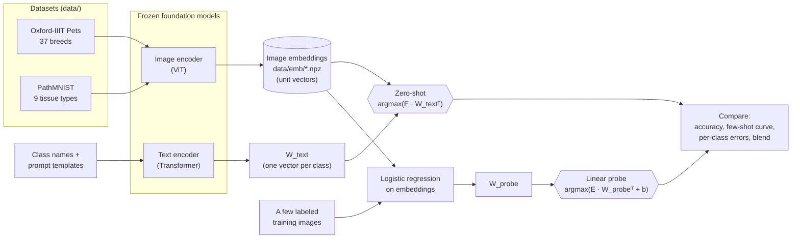

The key idea: **zero-shot and linear probing build the same kind of classifier**, a weight matrix `W` of shape `(n_classes, d)` applied to the same frozen image embeddings. The only difference is where `W` comes from:

| | Where `W` comes from | Needs labels? | Tests which part of the model? |
|---|---|---|---|
| **Zero-shot** | embeddings of text prompts, one per class | no | text–image alignment |
| **Linear probe** | logistic regression fit on labeled image embeddings | yes | image features only |

---

## 2. Background

### 2.1 How CLIP learns a shared space

CLIP was trained on 400M (image, caption) pairs scraped from the web. Each training batch holds `N` pairs. Both encoders embed their inputs, and the model computes all `N × N` image–caption similarities. The loss rewards the diagonal (true pairs) and penalizes everything else.

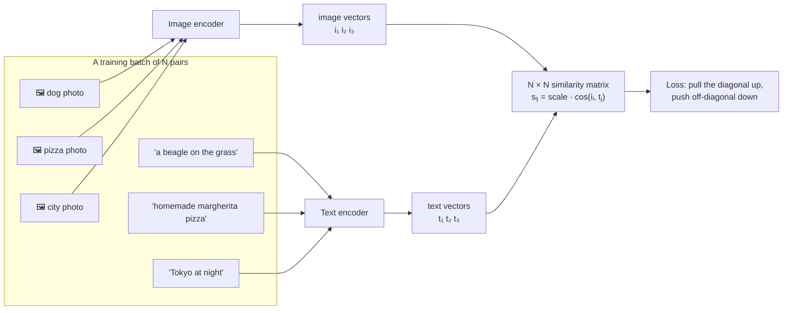

```
                 t₁ (beagle)   t₂ (pizza)   t₃ (Tokyo)
  i₁ (dog)     [    HIGH    ]     low          low
  i₂ (pizza)        low      [    HIGH   ]     low
  i₃ (city)         low           low      [   HIGH   ]
```

After training, "how well does this caption describe this image?" is a dot product. That is all zero-shot classification needs.

### 2.2 CLIP vs. SigLIP

The two models differ mainly in the loss, which changes how their scores should be read:

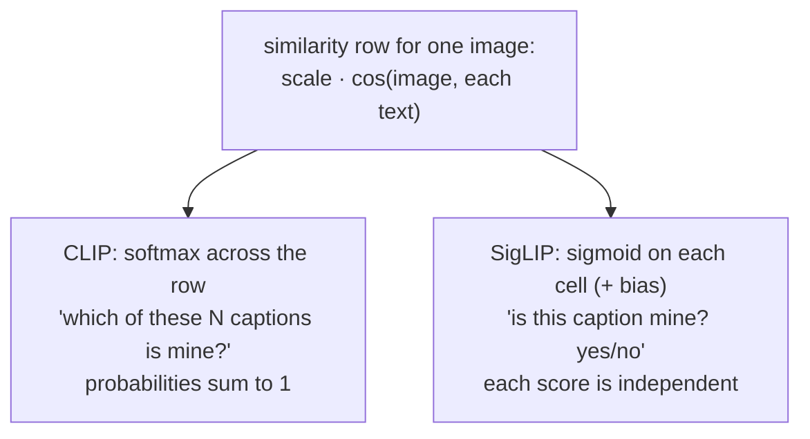

| | CLIP ViT-B/32 | SigLIP ViT-B/16 |
|---|---|---|
| Training data | 400M pairs (WIT) | ~10B pairs (WebLI) |
| Loss | softmax contrastive (InfoNCE) | pairwise sigmoid |
| Score for a class | `softmax(100 · cos)` | `sigmoid(117 · cos − 12.9)` |
| Image tokens | 49 (32-px patches) | 196 (16-px patches) |
| Embedding dim | 512 | 768 |
| Text padding at inference | dynamic | must pad to 64 tokens (`padding="max_length"`) |

For single-label classification the **argmax is identical** under both readings. The difference matters when you want calibrated probabilities, or "none of the above" / multi-label behavior. SigLIP's sigmoid scores handle those naturally.

### 2.3 Zero-shot classification

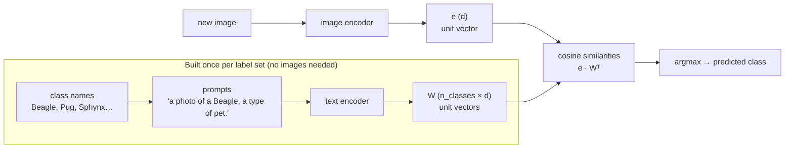

Because `W` is built from text, you can add, rename or remove classes by editing a list of strings.

### 2.4 Prompt engineering and prompt ensembling

The text encoder was trained on captions, not bare words. So the same class can get a better or worse vector depending on the sentence around it. Three levers are tested in notebook 02:

1. **Template**: `"Beagle"` → `"a photo of a Beagle."`
2. **Context**: `"… , a type of pet."` or `"a histopathology image of …"`. This disambiguates words with several meanings: *Boxer* (dog vs. athlete), *Sphynx* (cat vs. monument), *debris*, *background*.
3. **Knowledge**: add what the class is or looks like: `"a breed of cat"`; `"fat cells with large empty white vacuoles"`.

**Prompt ensembling** averages the embeddings of many phrasings into one class vector, so no single wording dominates:

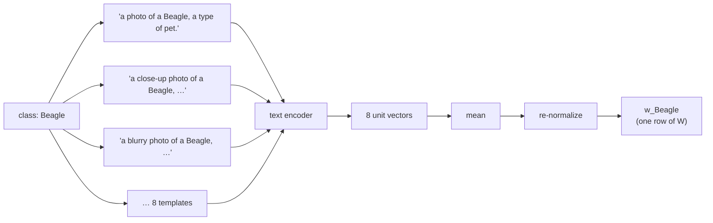

### 2.5 Linear probe

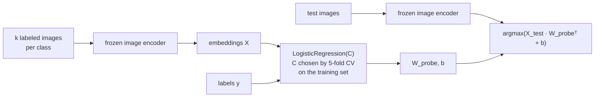

No weights inside the foundation model change. The probe is a few thousand parameters, fits in under a second, and measures how **linearly separable** the classes already are in embedding space.

### 2.6 The tradeoff, as a decision

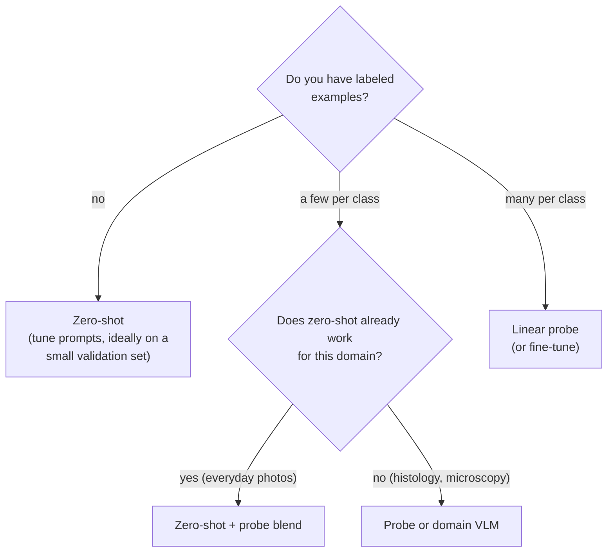

* **Zero-shot + probe blend:** use the zero-shot classifier as a prior and add a probe trained on the few labels you have (notebook 03 §4).
* **Probe or domain VLM:** train a few-shot linear probe, or switch to a domain-specific vision–language model (e.g. a pathology model such as PLIP or CONCH) and try zero-shot again.

---

## 3. Project layout

```
zero_shot_image_classification/
├── README.md                  ← this file
├── clip_utils.py              ← shared plumbing: datasets, models, embedding cache, zero-shot weights
├── 01_embeddings.ipynb        ← models, datasets, shared-space demo, modality gap, UMAP, embeds + caches all images
├── 02_zero_shot.ipynb         ← zero-shot classification, softmax vs sigmoid, prompt engineering, errors
├── 03_linear_probe.ipynb      ← linear probe, few-shot curve, per-class comparison, zero-shot + probe blend
├── requirements.txt           ← top-level dependencies
├── requirements-lock.txt      ← exact versions used for the saved run
├── data/                      ← downloaded datasets + data/emb/ embedding cache (git-ignored)
├── figs/                      ← figures written by the notebooks
└── results/                   ← CSVs and saved zero-shot classifiers
```

The notebooks run in order. Only notebook 01 touches the image encoders; after that everything is matrix algebra on cached vectors.

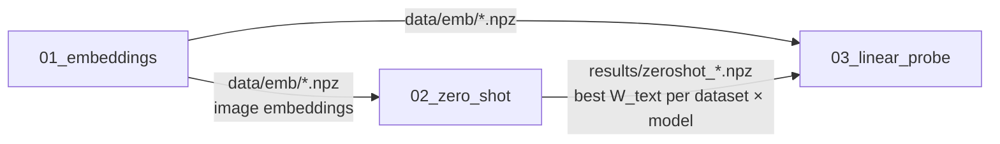

### Notebook walkthrough

| Notebook | § | What happens | Concept |
|---|---|---|---|
| 01 | 1 | Load CLIP and SigLIP; print sizes, embedding dims, learned logit scale/bias | Two-tower vision–language models |
| | 2 | Load Pets and PathMNIST subsamples; show one image per class | Train/test discipline |
| | 3 | 6 images × 6 captions cosine-similarity heatmap, both models | The shared embedding space |
| | 4 | Embed every image with both models, cache to `data/emb/` | Frozen feature extraction |
| | 5 | Histograms of image–image, text–text and image–text similarity | The **modality gap** |
| | 6 | UMAP of test embeddings, colored by class | Class structure without any text |
| 02 | 1 | Zero-shot Pets in five lines | Text vectors as classifier weights |
| | 2 | Top-5 scores for one image under CLIP (softmax) and SigLIP (sigmoid) | How to read the scores |
| | 3 | 6 prompt strategies × 2 datasets × 2 models | **Prompt engineering** and ensembling |
| | 4 | Confusion matrices and misclassified examples | What zero-shot gets wrong |
| | 5 | Save best text classifiers for notebook 03 | |
| | 6 | Zero-shot on your own unlabeled photos (`data/unlabeled/`) | The practical use case |
| 03 | 1 | Logistic regression on 50 images/class, `C` by 5-fold CV | **Linear probe** |
| | 2 | Probe accuracy at k = 1…50 shots (5 seeds) vs. zero-shot line | How many labels is a prompt worth? |
| | 3 | Per-class accuracy, zero-shot vs. probe | Which classes language fails on |
| | 4 | `log p_zero-shot + log p_probe` | Zero-shot as a prior |
| | 5 | Summary table | |

---

## 4. Setup and running

Everything runs on a laptop CPU (developed on an Intel Mac with no GPU). If CUDA or Apple MPS is available, `clip_utils.DEVICE` uses it automatically.

```bash
git clone https://github.com/ynewt/zero_shot_image_classification.git
cd zero_shot_image_classification
python3.12 -m venv .venv
.venv/bin/pip install -r requirements.txt        # or requirements-lock.txt for exact versions
.venv/bin/python -m ipykernel install --user --name zsic --display-name "zsic (3.12, CLIP/SigLIP CPU)"
```

Then open the notebooks in VS Code or Jupyter, pick the **zsic** kernel, and run 01 → 02 → 03. Or headless:

```bash
for nb in 01_embeddings 02_zero_shot 03_linear_probe; do
  .venv/bin/jupyter nbconvert --to notebook --execute --inplace $nb.ipynb
done
```

**Downloads on first run** (cached afterwards):

| What | Size | Source |
|---|---|---|
| Oxford-IIIT Pets | 790 MB | Hugging Face mirror `timm/oxford-iiit-pet` (the official Oxford server is very slow) |
| PathMNIST 64×64 | 1.07 GB | Zenodo, via the `medmnist` package |
| CLIP ViT-B/32 | ~600 MB | Hugging Face |
| SigLIP ViT-B/16 | ~800 MB | Hugging Face |

**Runtime** on a 4-core Intel i7 laptop CPU: notebook 01 takes about 18 minutes (embedding ~4,300 images: ~5 min with CLIP B/32, ~13 min with SigLIP B/16, plus UMAP). Re-running it with the cache in place takes a couple of minutes. Notebooks 02 and 03 take 1–2 minutes each.

**Knobs** in [clip_utils.py](clip_utils.py):

* `SPLIT_SIZES`: images per class per split. Defaults: Pets 50 train / 30 test (1,850 / 1,110 images); PathMNIST 50 train / 100 test (450 / 900).
* `PATHMNIST_SIZE`: 28, 64, 128 or 224 px. 64 is a compromise; the original NCT-CRC-HE tiles are 224 px, but that file is 12.6 GB.
* `MODELS`: swap in any Hugging Face CLIP/SigLIP checkpoint (e.g. `openai/clip-vit-large-patch14`, `google/siglip-so400m-patch14-384`). Bigger models are better and much slower on CPU.

**Your own photos.**

* *Unlabeled:* put images in `data/unlabeled/`, edit `MY_LABELS` in notebook 02 §6, and run that cell.
* *Labeled:* put them in `data/my_photos/<class name>/…`. Half of each class becomes train, half test. Add `"my_photos"` to the dataset lists in the notebooks, and write a prompt strategy for it in notebook 02.

---

## 5. Results

From the saved run (CPU, seed 0). Test sets: 1,110 Pets images (30 per breed) and 900 PathMNIST tiles (100 per tissue type). Chance is 2.7% for Pets and 11.1% for PathMNIST.

### 5.1 Headline

| Dataset | Model | Best zero-shot | Probe, 1 label/class | Probe, 16/class | Probe, 50/class | Labels/class for the probe to match zero-shot |
|---|---|---|---|---|---|---|
| Pets | CLIP | **90.7%** | 36.2% | 81.0% | 87.0% | **> 50** |
| Pets | SigLIP | **95.0%** | 61.7% | 91.6% | 94.0% | **> 50** |
| PathMNIST | CLIP | 25.6% | 45.0% | 77.2% | **83.4%** | **< 1** |
| PathMNIST | SigLIP | 35.2% | 45.7% | 74.6% | **81.1%** | **< 1** |

(Few-shot numbers are means over 5 random draws of the labeled images. "50/class" is the full probe with `C` chosen by cross-validation. The k = 50 point of the few-shot curve, used in §5.5, refits the same model on the same images in a different row order and lands within 0.5 points.)

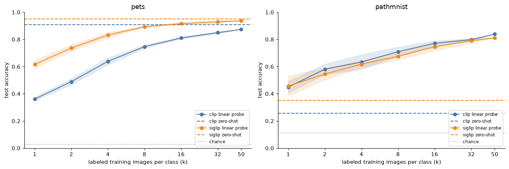

**The tradeoff, in one figure.** On Pets the dashed zero-shot lines sit above the entire probe curve: a few sentences of text beat 1,850 labeled photos. On PathMNIST, one labeled tile per class already beats the best prompt, and 50 per class reach 81–84%. Same models, same frozen image features, opposite conclusions. What changed is whether the model's **language side** knows the domain.

### 5.2 Prompt engineering (notebook 02)

| Strategy | Pets CLIP | Pets SigLIP | PathMNIST CLIP | PathMNIST SigLIP |
|---|---|---|---|---|
| name only | 80.8% | 92.9% | 17.6% | 25.3% |
| "a photo of a {}" | 86.4% | 93.6% | 24.1% | 20.0% |
| + domain context | 87.9% | 94.3% | 19.7% | 25.4% |
| + species / + descriptions | 89.8% | 94.7% | **25.6%** | 31.0% |
| ensemble | 88.7% | 94.4% | 17.7% | 28.2% |
| ensemble + species / descriptions | **90.7%** | **95.0%** | 25.2% | **35.2%** |

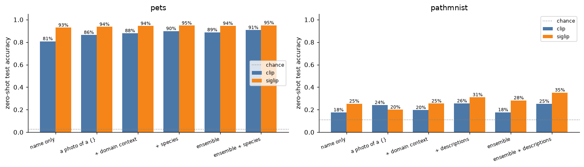

* **On Pets, prompts are worth 10 points for CLIP.** A sentence template, domain context ("a type of pet") and injected knowledge ("a breed of cat") each add a step. SigLIP is far less sensitive to wording: bare breed names already get 92.9%.
* **On PathMNIST, nothing works well, and the effects are erratic.** Visual descriptions help most. But "a photo of …" helps CLIP and hurts SigLIP, and ensembling helps SigLIP and hurts CLIP. That is what prompt tuning looks like when the model has no real grip on the domain.

### 5.3 What zero-shot gets wrong

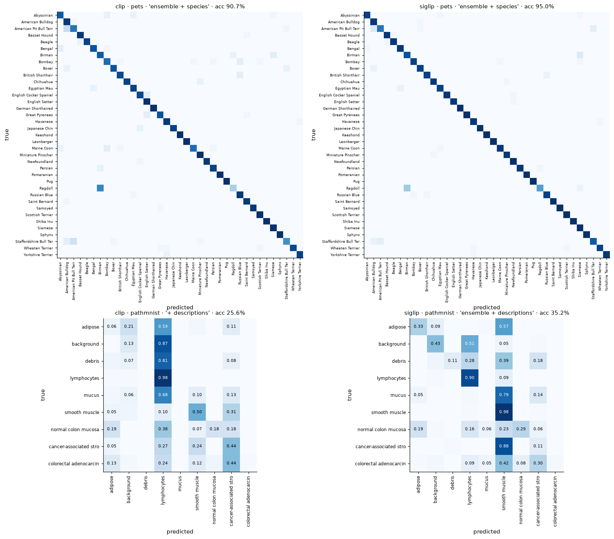

* **Pets:** errors are between look-alike breeds (Ragdoll → Birman / Siamese; American Pit Bull Terrier → American Bulldog / Staffordshire Bull Terrier). These are expert-level distinctions.
* **PathMNIST:** errors collapse into **attractor columns**. CLIP labels most tissue *lymphocytes* (87% of background, 81% of debris tiles); SigLIP labels most tissue *smooth muscle* (88% of stroma, 79% of mucus). Mucus and adenocarcinoma epithelium are essentially never predicted correctly. The text side can't tell these classes apart.

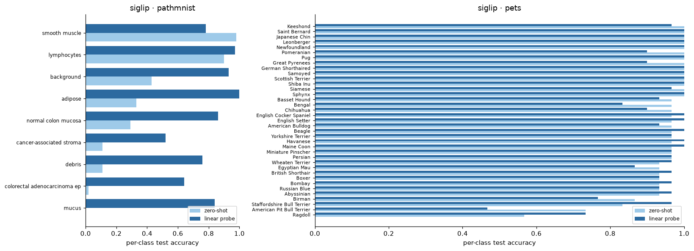

Yet the image side can. The UMAP from notebook 01 shows clear tissue clusters with no labels used at all, and the probe recovers most classes:

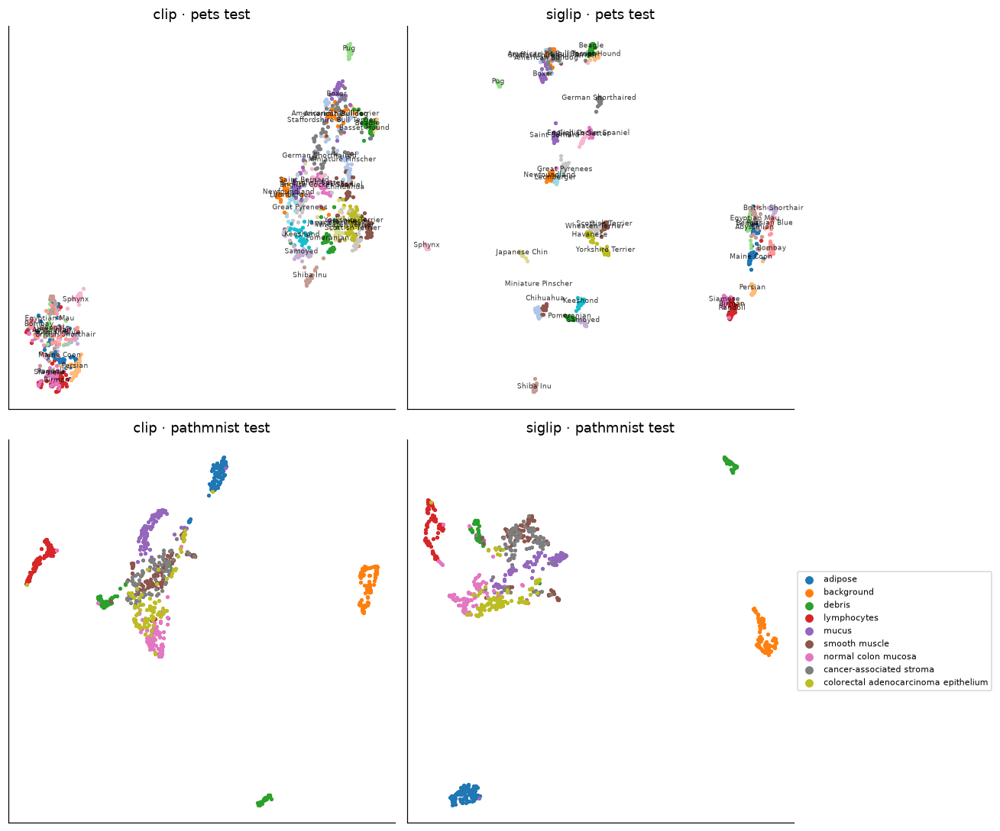

### 5.4 The shared space and the modality gap (notebook 01)

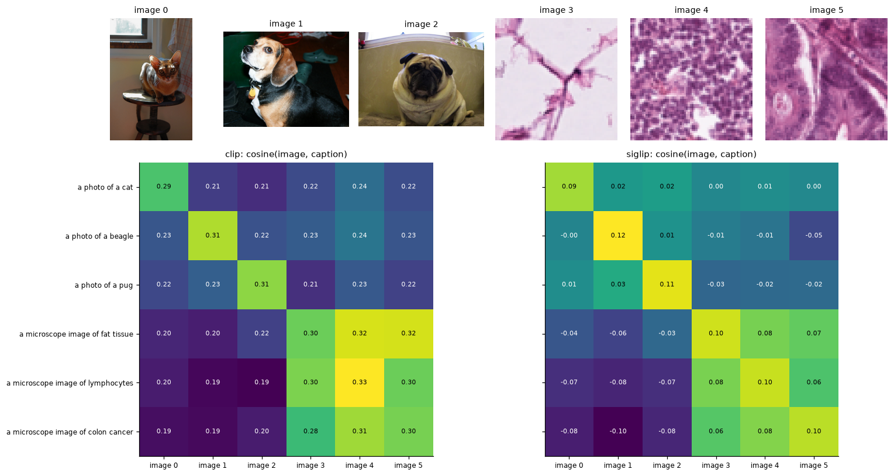

For the pets, both models light up the diagonal. For the tiles, CLIP knows they are "microscope images" (the whole lower-right block is bright) but scores each tile ~0.30–0.33 against all three tissue captions.

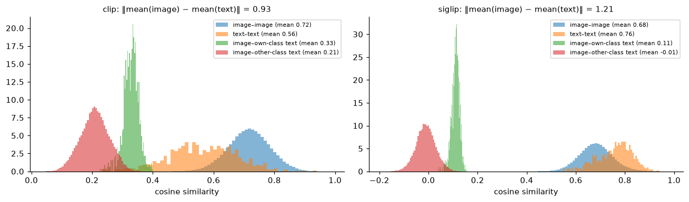

Image–text similarities (green, red) sit far below image–image and text–text ones, even for correct pairs. That is the modality gap. The classification signal is the small margin between own-class text (green) and other-class text (red), e.g. 0.33 vs. 0.21 for CLIP, stretched into probabilities by the logit scale of ~100.

### 5.5 Blending zero-shot with a few-shot probe

Adding the two classifiers' log-probabilities (equal weights):

| | k = 1 | k = 4 | k = 16 | k = 50 |
|---|---|---|---|---|
| Pets CLIP: probe → blend | 36.2% → **88.2%** | 63.9% → **89.8%** | 81.0% → **91.1%** | 87.4% → **92.2%** |
| Pets SigLIP: probe → blend | 61.7% → **94.6%** | 83.2% → **94.9%** | 91.6% → **95.1%** | 93.7% → **95.4%** |
| PathMNIST CLIP: probe → blend | 45.0% → **48.2%** | **63.4%** → 61.3% | **77.2%** → 74.8% | **83.9%** → 81.8% |
| PathMNIST SigLIP: probe → blend | 45.7% → **48.7%** | **61.8%** → 58.8% | **74.6%** → 67.4% | **81.2%** → 72.8% |

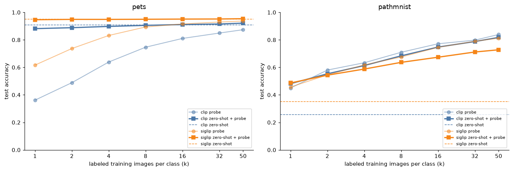

A good zero-shot classifier is a strong prior: on Pets the blend beats both of its parts at every `k`, and with 50 labels/class it edges past zero-shot alone. A bad zero-shot classifier is a bad prior: on PathMNIST it helps only at `k = 1`, then drags accuracy down, because its confident attractor label keeps pulling predictions.

### 5.6 What to take away

1. **Zero-shot is a linear classifier whose weights are written in English.** Its ceiling is set by how well the model's captions covered your domain.
2. **For everyday imagery, zero-shot is the strong baseline to beat.** Here it was worth more than 50 labeled images per class.
3. **For specialized imagery (histology), labels win immediately.** The frozen image features are good; one labeled example per class beats any prompt tried.
4. **Better zero-shot doesn't mean better features.** SigLIP beat CLIP at zero-shot on both datasets, but CLIP's features probed slightly better on PathMNIST (83.4% vs. 81.1%).
5. **Prompt engineering is real but bounded.** It moved CLIP on Pets by 10 points. It cannot fix a missing text–image link.

---

## 6. Key concepts, briefly

* **Embedding.** A fixed-length vector standing for an input. Here every vector is L2-normalized, so a dot product *is* cosine similarity.
* **Shared (joint) embedding space.** Two encoders trained so that matching image–text pairs land close together. "Closeness" between modalities becomes meaningful.
* **Logit scale (temperature).** Cosine similarities differ by only a few hundredths between right and wrong classes. The learned scale (~100) stretches those gaps into confident probabilities.
* **Modality gap.** Image vectors and text vectors occupy different regions of the shared space. Image–text similarity is low in absolute terms even for correct pairs. Only the *ranking* within an image's row is meaningful.
* **Zero-shot.** No labeled examples of the target classes. "Zero-shot" doesn't mean the model never saw a beagle; it means it was never trained *on this classification task*.
* **Prompt ensembling.** Average the text embeddings of several phrasings of the same class.
* **Linear probe.** Frozen encoder + logistic regression. The standard way to measure how much task-relevant information a representation holds in an easily readable form.
* **Few-shot curve.** Probe accuracy as a function of labeled examples per class. Where it crosses the zero-shot line tells you how many labels a good prompt is "worth".
* **Distribution shift / domain gap.** When target images (histology) look nothing like the pretraining data (web photos with captions), the text–image bridge breaks down first. The image features often still carry the signal.

---

## 7. Caveats

* **Prompts were chosen on the test set** (notebook 02 picks the best strategy by test accuracy). That is acceptable for learning, but it slightly flatters zero-shot. A rigorous version would select prompts on a validation split.
* **Few-shot `C` comes from full-data CV.** With one image per class you cannot cross-validate, so the few-shot probes reuse the `C` chosen with all 50 images/class. This slightly favors the low-`k` probe.
* **Small samples.** 30 test images per Pets breed means each per-class accuracy moves in steps of 3.3 points. Overall accuracies are tighter (1,110 and 900 test images), roughly ±1–1.5 points standard error.
* **PathMNIST is downsampled to 64 px** and stain-normalized, then upsampled to 224 px by the model processor. Real 224-px tiles would help both methods.
* **Possible pretraining overlap.** Oxford Pets images are on the public web, so some may have been in CLIP's or SigLIP's training data. This is a general caveat for zero-shot benchmarks on web-scale models.

---

## 8. Extensions

1. **Domain-specific vision–language models for pathology.** Re-run notebook 02 with a model trained on histology image–text pairs, e.g. **BiomedCLIP** (`microsoft/BiomedCLIP-PubMedBERT_256-vit_base_patch16_224`, via `open_clip`), **PLIP** (`vinid/plip`, a standard CLIP checkpoint that loads with this code), **QuiltNet**, or **CONCH** (gated). The question: does the PathMNIST zero-shot line jump up?
2. **Bigger general models.** `openai/clip-vit-large-patch14` or `google/siglip-so400m-patch14-384`. Does scale close the histology gap, or only improve Pets?
3. **Proper prompt selection.** Split the training set into train/validation and choose the prompt strategy on validation only.
4. **Better blending.** Tune the zero-shot weight on validation data, initialize the probe from `W_text` (warm start), or implement Tip-Adapter / WiSE-FT.
5. **LLM-generated descriptions.** Ask an LLM "what does a {class} look like?" and use the answers as prompts (the "CuPL" method; Pratt et al., 2023).
6. **Open-set behavior.** Add a "none of the above" class, or threshold SigLIP's sigmoid scores, and test on images from the *other* dataset.
7. **Microscopy beyond H&E.** Other MedMNIST sets (BloodMNIST, DermaMNIST, OrganAMNIST) only need a new entry in `load_imageset` and a prompt strategy.

---

## 9. References

* Radford et al., 2021. *Learning Transferable Visual Models From Natural Language Supervision* (CLIP). arXiv:2103.00020
* Zhai et al., 2023. *Sigmoid Loss for Language Image Pre-Training* (SigLIP). arXiv:2303.15343
* Liang et al., 2022. *Mind the Gap: Understanding the Modality Gap in Multi-modal Contrastive Representation Learning.* arXiv:2203.02053
* Pratt et al., 2023. *What does a platypus look like? Generating customized prompts for zero-shot image classification* (CuPL). arXiv:2209.03320
* Parkhi et al., 2012. *Cats and Dogs* (Oxford-IIIT Pets). CVPR.
* Kather et al., 2019. *Predicting survival from colorectal cancer histology slides using deep learning* (NCT-CRC-HE-100K, source of PathMNIST). PLoS Medicine.
* Yang et al., 2023. *MedMNIST v2.* Scientific Data.
